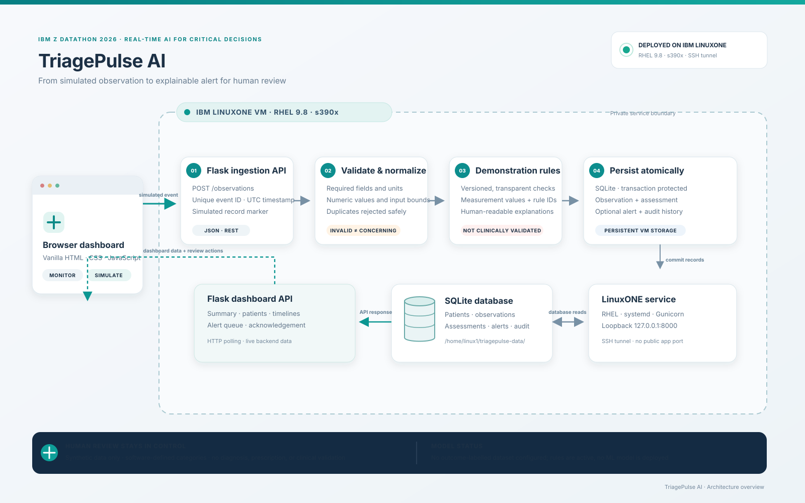
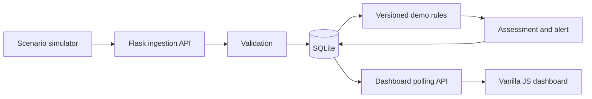

# Architecture

Browser (vanilla HTML/CSS/JS) polls the Flask API. Observation POSTs are validated, persisted in SQLite in one transaction, assessed with versioned demonstration rules, and optionally create a deduplicated alert. Acknowledgement appends an audit record and leaves the source observation intact. API latency counters use a bounded in-memory sample; persistent records use SQLite. There is no external cloud dependency.

The system is educational and not clinically validated. Rule thresholds are demonstration settings, not authoritative clinical thresholds.
